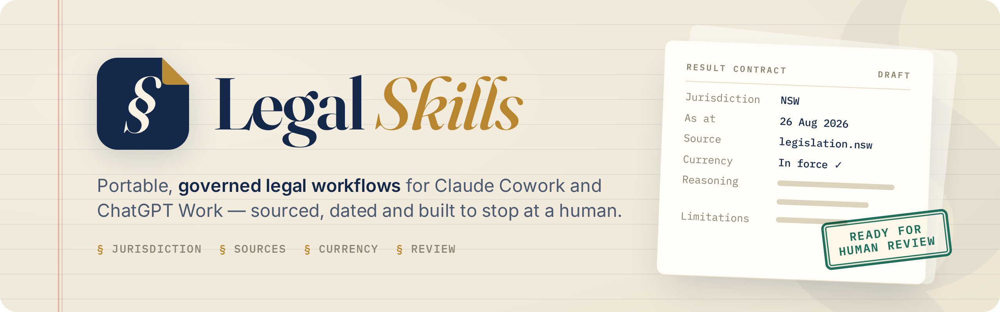
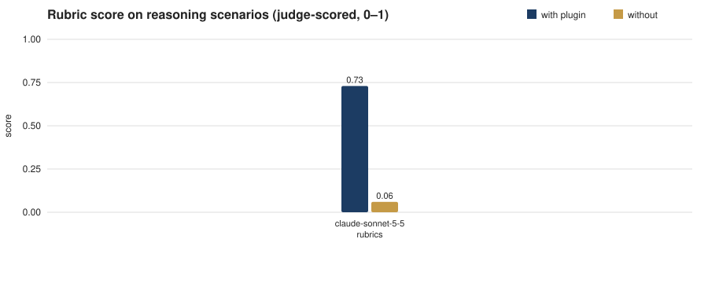
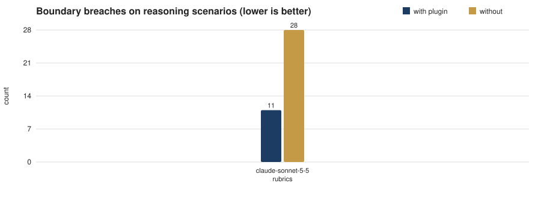

<picture>
  <source media="(prefers-color-scheme: dark)" srcset="docs/assets/legal-skills-banner-dark.png">
  
</picture>

<p align="center">
  <a href="https://github.com/l0cka/legal-skills/actions/workflows/ci.yml"></a>
  <a href="LICENSE"></a>
  <!-- generated:badges -->
  
  
  
<!-- end:badges -->
</p>

# Legal Skills

Ready-made legal workflows for your AI assistant. Install them once and
Claude (Cowork or Claude Code) or ChatGPT (Work or Codex) can check
Australian citations, map privacy and AML/CTF obligations, compute candidate
court deadlines, build chronologies and more, always in a way that states
its sources and leaves the final call to a person.

Free and open source (MIT).

## What's included

<!-- generated:counts -->
One plugin, `legal-skills`, holds one hundred and three skills across sixteen practice areas:
<!-- end:counts -->

<!-- generated:area-table -->
| Practice area | Skills | Description | Law checked |
| --- | :---: | --- | :---: |
| [**Australian AI Governance**](plugins/legal-skills/areas/ai-governance/README.md) | 6 | Maps the AI rules and guidance that apply to an Australian organisation. Shows which items are law and which are only guidance. | 2026-08-26 |
| [**Australian AML/CTF**](plugins/legal-skills/areas/aml-ctf/README.md) | 5 | Finds the AML/CTF obligations of an Australian legal practice under the tranche 2 reforms. A person must approve each report and decision. | 2026-08-26 |
| [**Australian Commercial Drafting**](plugins/legal-skills/areas/commercial-drafting/README.md) | 6 | Drafts Australian NDAs, subscription terms, privacy policies and services agreements for lawyer review. | 2026-10-13 |
| [**Australian Consumer & Competition**](plugins/legal-skills/areas/consumer-competition/README.md) | 7 | Maps consumer guarantees, marketing, merger notification, competition conduct and product safety for lawyer review. | 2026-10-13 |
| [**Australian Contract Review**](plugins/legal-skills/areas/contract-review/README.md) | 7 | Reviews inbound Australian contracts against standard positions, fallbacks and approval thresholds. | 2026-10-13 |
| [**Australian Corporations Governance**](plugins/legal-skills/areas/corporations-governance/README.md) | 5 | Helps govern an Australian company under the Corporations Act. Prepares board records and reviews for human approval. | 2026-08-26 |
| [**Australian Employment & Fair Work**](plugins/legal-skills/areas/employment-fair-work/README.md) | 10 | Maps Fair Work obligations and reviews contracts, classification, discrimination, restraints and underpayment frameworks for lawyers. | 2026-08-26 |
| [**Australian Estate Planning**](plugins/legal-skills/areas/estate-planning/README.md) | 3 | Prepares solicitor-review drafts from approved NSW, Victorian and Queensland estate planning precedents. | 2026-08-26 |
| [**Australian Legal Research**](plugins/legal-skills/areas/legal-research/README.md) | 16 | Checks Australian legislation and case citations against the official publishers. Writes and reviews AGLC4 citations. | 2026-08-26 |
| [**Australian Litigation Deadlines**](plugins/legal-skills/areas/litigation-deadlines/README.md) | 6 | Maps limitation periods and computes candidate court deadlines. A lawyer must confirm each date. | 2026-08-26 |
| [**Australian Privacy & Cybersecurity**](plugins/legal-skills/areas/privacy-cybersecurity/README.md) | 8 | Maps the Australian privacy and cyber rules that can apply to a set of facts, a data breach or an AI use case. | 2026-08-26 |
| [**Australian Work Health & Safety**](plugins/legal-skills/areas/work-health-safety/README.md) | 5 | Maps WHS duty holders, assesses candidate notifiable incidents, reviews officer due diligence evidence and psychosocial controls for lawyer review. | 2026-10-28 |
| [**Legal Evidence Workflows**](plugins/legal-skills/areas/evidence-workflows/README.md) | 4 | Builds source-linked Word document indexes, chronologies, privilege logs and inconsistency maps from supplied matter documents without deciding credibility, privilege or merits. | 2026-08-26 |
| [**Legal Triage**](plugins/legal-skills/areas/triage/README.md) | 2 | Helps community legal centre staff record and triage legal enquiries under an approved profile. | 2026-08-26 |
| [**Legal Workflow Router**](plugins/legal-skills/areas/workflow-router/README.md) | 1 | Maps a fact pattern to the skills it engages, in order, with the human decision points named. | 2026-08-26 |
| [**Legal Cognitive Sparring**](plugins/legal-skills/areas/cognitive-sparring/README.md) | 12 | Spars with a qualified lawyer on reasoning, gaps, and strategy. Jurisdiction is lawyer-supplied. It does not give final advice or invent citations. | 2026-10-15 |
<!-- end:area-table -->

"Law checked" is the date each practice area's sources were last reviewed
against the law. Most areas cover Australian law.

## Install

### The easy way: ask your assistant

Paste this into Claude or ChatGPT (any version that can manage plugins):

<!-- generated:install-agent -->
```text
Add the plugin marketplace `l0cka/legal-skills` and install its
`legal-skills` plugin (user scope if supported). Verify the plugin is
available and report the result.
```
<!-- end:install-agent -->

Claude Cowork users can instead add `l0cka/legal-skills` from the personal
plugin marketplace. ChatGPT Work availability depends on your plan and
workspace plugin settings.

### From a terminal

<details>
<summary><b>Claude Code</b></summary>

<!-- generated:install-claude -->
```bash
claude plugin marketplace add l0cka/legal-skills
claude plugin install legal-skills@legal-skills --scope user
```
<!-- end:install-claude -->

</details>

<details>
<summary><b>Codex</b></summary>

<!-- generated:install-codex -->
```bash
codex plugin marketplace add l0cka/legal-skills
codex plugin add legal-skills@legal-skills
```
<!-- end:install-codex -->

</details>

One install gives you every skill. Upgrading from the separate
`australian-*` and `legal-*` plugins? Uninstall them first; see the
[changelog](CHANGELOG.md).

## Before you rely on it

- **A person stays in charge.** Every skill prepares work for a lawyer or
  other qualified person to check and approve. None of them gives legal
  advice or replaces professional judgment.
- **Sources are shown.** Outputs state the jurisdiction, the sources used,
  how current they are, and any assumptions.
- **Leads are not authority.** Search results and secondary material are
  flagged as leads; legal propositions rely on primary or authoritative
  sources.
- **No confidential content ships here.** The skills contain no client,
  matter or privileged information. Take care with what you share with your
  assistant under your own firm's policies.

## Benchmarks

We measure how answers change with and without the plugin on answer-keyed
and rubric-scored Australian legal tasks. See
[benchmarks/README.md](benchmarks/README.md) for the method.

<!-- benchmarks:start -->
Models: claude-sonnet-5-5 (claude). Cases: 37. Full per-cell numbers: `python3 benchmarks/report.py <results dirs>`.





- **claude-sonnet-5-5** (claude) rubrics: rubric 0.73 with vs 0.06 without; boundary breaches 11 vs 28
<!-- benchmarks:end -->

The recorded run is from 28 October 2026: two runs with the plugin and one
without. The official publishers could not be reached from the test
environment, so the answer-keyed verification sets were not run, and rubric
items that need a successful live check could not be met.

## Contributing

Contributions are welcome. Start with [CONTRIBUTING.md](CONTRIBUTING.md),
then see [docs/adding-a-skill.md](docs/adding-a-skill.md) and
[docs/architecture.md](docs/architecture.md) for how the repository fits
together. [CHANGELOG.md](CHANGELOG.md) records what has changed.

## Licence

MIT. See [LICENSE](LICENSE).
